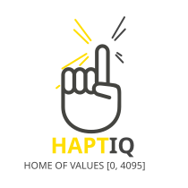
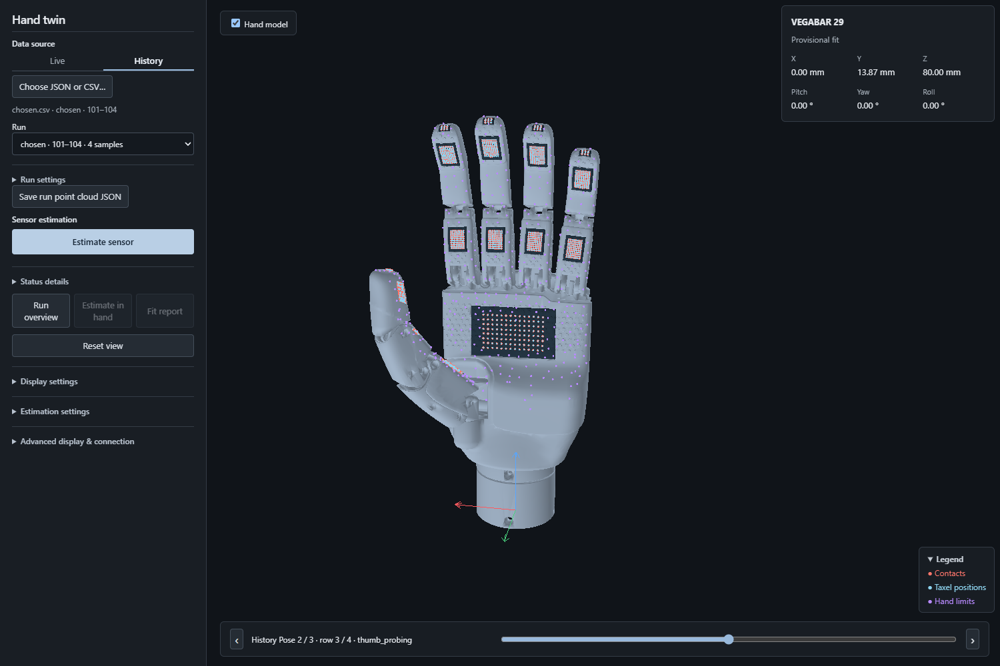
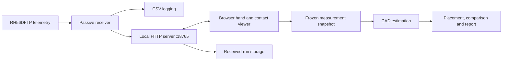

<p align="center">
  
</p>

# HaptIQ Hand

**Live tactile telemetry, an articulated 3D hand viewer, and CAD-based sensor estimation for the Inspire Robots RH56DFTP.**

[](https://github.com/kooglersHub/haptiq-hand/actions/workflows/checks.yml)

[Quick start](#quick-start) · [Architecture](docs/ARCHITECTURE.md) · [Developer guide](docs/TESTING.md) · [Technical handover](docs/HANDOVER.md)

HaptIQ connects measured joint angles and tactile readings to an interactive hand model.
Inspect live contacts, replay recorded grasps, and compare sensor CAD models against a frozen
measurement snapshot—all through one local browser application.



*History workspace with synthetic test data. A provisional placement does not confirm sensor identity.*

## What you can do

| Capability | What it provides |
| --- | --- |
| **Inspect the hand** | Articulated kinematics, 1,062 taxels across 17 fields, contact normals and hand-surface limits. |
| **Follow live telemetry** | Actual joint feedback and tactile readings from a passive Modbus receiver. |
| **Explore manual poses** | Adjust the virtual hand without moving physical hardware. |
| **Record and replay grasps** | Capture incoming runs, load JSON or CSV recordings, inspect individual poses and reconstruct accumulated contacts. |
| **Estimate sensor placement** | Fit and compare the bundled VEGABAR 29 and VEGABAR 38 CAD models, with quick and detailed search modes. |
| **Extend the project** | Add candidates through a shared catalog and work within separate telemetry, capture, estimation, server and viewer packages. |

The separate **Blackforest** application controls physical hand motion. HaptIQ's receiver
reads telemetry; its normal startup does not send motion, calibration or configuration writes.

## Quick start

### Requirements

- **Python 3.13+**, with Python 3.14 used for the local verification.
- **[uv](https://docs.astral.sh/uv/)** for Python installation and dependency management.
- A **WebGL2-capable browser**.
- **Node.js 24 and npm** when developing or running JavaScript/browser tests.

The viewer and recorded-data workflows can run without connected hardware.

### 1. Get the project

```sh
git clone https://github.com/kooglersHub/haptiq-hand.git
cd haptiq-hand
```

### 2. Install and open the viewer

On Windows, double-click **[Start Sensor Identification.cmd](Start%20Sensor%20Identification.cmd)**.
The launcher prepares the Python environment and opens the application.

For a terminal-based start:

```sh
uv sync --locked --extra sensor-identification
uv run --no-sync haptiq-viewer
```

Open **[http://127.0.0.1:18765/](http://127.0.0.1:18765/)**.
This single server handles the viewer, telemetry, shared taxel positions, received captures
and estimation. The Windows launcher reuses a current viewer or replaces a verified outdated
viewer from the same checkout. Use `haptiq-viewer --no-browser` to start without opening a tab.

### 3. Choose your data

- **Live:** follow incoming telemetry, or disable **Follow live telemetry** to explore manual angles.
- **History:** choose a contact JSON or telemetry CSV, select a run and inspect its recorded poses.
- **Estimate sensor:** fit the exact frozen snapshot currently selected. Compare candidates,
  inspect the provisional placement and open the detailed fit report.

To receive measurements from a connected hand, start a second terminal:

```sh
uv run --no-sync haptiq
```

The receiver is a separate process; the browser application continues to use the same server.

## Configuration and saved data

| Setting | Default | Purpose |
| --- | --- | --- |
| `HAND_IP` | `192.168.123.210` | Hand endpoint used by the passive receiver. |
| `HAND_PORT` | `6000` | Modbus TCP port. |
| `HAND_DATA_DIR` | `~/Documents/ChatGPT/hand/probing_situations` | Writable root for new recordings and reports. |
| `HAND_CAPTURE_DIR` | `<data-root>/received_runs` | Optional override for received-run storage. |

For example, in PowerShell:

```powershell
$env:HAND_IP = "192.168.123.210"
$env:HAND_PORT = "6000"
$env:HAND_DATA_DIR = "$env:USERPROFILE\Documents\HaptIQ"
uv run --no-sync haptiq
```

Set variables before starting the affected process. [.env.example](.env.example) documents the
available settings; `.env` files are not loaded automatically. Recordings and reports are stored
outside the installed package. Local recordings, environments and development caches are
excluded from Git. Existing historical files are preserved during the project migration.

## Architecture



| Location | Responsibility |
| --- | --- |
| [`src/haptiq/telemetry/`](src/haptiq/telemetry/) | Read-only Modbus acquisition, dataset storage and HTTP publishing. |
| [`src/haptiq/capture/`](src/haptiq/capture/) | Received runs and shared taxel snapshot persistence. |
| [`src/haptiq/estimation/`](src/haptiq/estimation/) | CAD loading, geometric search, evidence evaluation and reporting. |
| [`src/haptiq/server/`](src/haptiq/server/) | HTTP validation, per-server state, routing and lifecycle. |
| [`src/haptiq/digital_twin/`](src/haptiq/digital_twin/) | Browser modules, editable templates, geometry sources and generated viewer. |
| [`src/haptiq/assets/models/`](src/haptiq/assets/models/) | Runtime STL files and the shared candidate catalog. |
| [`src/haptiq/logic/`](src/haptiq/logic/) | Passive grasp observation and retained analysis components. |
| [`documents/`](documents/) | Original STEP exports and hardware reference material. |
| [`tests/`](tests/) | Python, native Node and browser integration checks. |

Viewer source modules and templates are maintained independently from generated HTML.
Rebuild after changing them:

```sh
uv run --no-sync haptiq-build-viewer
uv run --no-sync haptiq-build-viewer --check
```

See [architecture](docs/ARCHITECTURE.md), [data contracts](docs/CONTRACTS.md) and
[extension guide](docs/EXTENDING.md) for dependency boundaries and implementation guidance.
Migration notes are in the [changelog](CHANGELOG.md).

## Estimation and interpretation

The estimator uses measured contact positions and normals, region-balanced residuals,
first-surface visibility, hand limits and multiple starting poses. Candidate metadata and CAD
hashes are shared between Python tools and the viewer. Source units and coordinate frames are
explicit; display transformations never become measurement evidence.

Inspect the bundled models without hardware:

```sh
uv run --no-sync haptiq-estimate --inspect
```

Geometry and taxel placement remain **approximate and uncalibrated**. A promising alignment,
an empirical starting pose and a confirmed identity are different outcomes. Open hand meshes,
sampled motion coverage and finite local search remain explicit limitations. Similar fits retain
ambiguity; rejected fits are available for deliberate comparison.

Read the [estimation guide](docs/ESTIMATION.md), [geometry notes](docs/GEOMETRY.md) and
[known limitations](issues.md) before interpreting results as physical accuracy.

## Development and verification

```sh
uv sync --locked --extra sensor-identification --group dev
npm ci
uv run --no-sync ruff check .
uv run --no-sync ruff format --check .
npm run format:check
uv run --no-sync haptiq-build-viewer --check
uv run --no-sync python -B -m unittest discover -s tests -v
npm test
uv run --no-sync python scripts/test-browser.py
```

On Linux, install the browser used by the integration suite first:

```sh
npx playwright install --with-deps chromium
```

Windows browser tests use Microsoft Edge by default. Each browser suite owns a temporary
server on an automatically assigned port and closes it in teardown. Tests do not connect to
physical hardware. GitHub Actions defines separate source/package and browser jobs.

The recorded local acceptance includes **193 Python tests, 17 native Node suites and
10 browser suites**. See the [verification record](docs/VALIDATION.md) for its environment and
scope; the badge above reports the current GitHub workflow status.

Build and verify a distributable wheel:

```sh
uv build --wheel
uv run --no-sync python scripts/check-wheel.py dist
```

The verifier checks package contents against current source, CAD hashes, CLI entrypoints and
viewer consistency, then imports the extracted package outside the checkout.
Full instructions are in [CONTRIBUTING.md](CONTRIBUTING.md) and the [developer guide](docs/TESTING.md).

## Project documentation

| Guide | Start here when you want to… |
| --- | --- |
| [Technical handover](docs/HANDOVER.md) | Onboard a new team, operate the application or prepare a release. |
| [Architecture](docs/ARCHITECTURE.md) | Understand ownership, dependencies and state lifecycles. |
| [Data contracts](docs/CONTRACTS.md) | Integrate telemetry, recordings or an HTTP client. |
| [Extension guide](docs/EXTENDING.md) | Add a CAD candidate, measurement source or server feature. |
| [Testing](docs/TESTING.md) | Run checks, diagnose regressions or verify a package. |
| [Estimation](docs/ESTIMATION.md) | Understand fitting behavior, tolerances and evidence. |
| [Geometry](docs/GEOMETRY.md) | Review frames, wiring, taxel construction and calibration assumptions. |
| [Roadmap](roadmap.md) | See remaining experimental and engineering work. |

## Provenance and third-party material

HaptIQ Hand derives from the [original HaptIQ project](https://github.com/rht2001/haptiq).
This repository maintains a cleaned public history of the application. Bundled hand geometry,
sensor CAD and reference documents retain their source attribution and hashes.
See [THIRD_PARTY_NOTICES.md](THIRD_PARTY_NOTICES.md) for provenance and asset terms;
no blanket license is assigned to third-party material by this repository.
