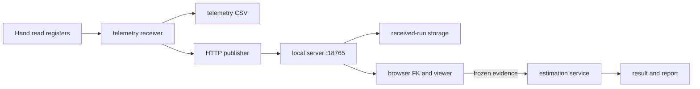

# Architecture

HaptIQ receives hand telemetry, reconstructs tactile geometry in the browser and fits CAD
candidates to frozen measurements. Physical motion belongs to the separate Blackforest program.

## Package boundaries

| Location | Responsibility | Must not do |
| --- | --- | --- |
| `haptiq.telemetry` | Read-only Modbus acquisition, CSV storage, bounded HTTP publishing | Command hardware motion |
| `haptiq.capture` | Persist received runs and fresh shared taxel snapshots | Recompute browser FK or invent missing readings |
| `haptiq.estimation` | Frame normalization, geometric search, evidence and reporting | Connect to the hardware or depend on HTTP handlers |
| `haptiq.server` | HTTP validation/routing, per-instance state and listener lifecycle | Own a Modbus connection |
| `haptiq.digital_twin` | Browser model, geometry assets and deterministic viewer build | Actuate the hand |
| `haptiq.logic` | Passive grasp observation and retained analysis components | Enter the hardware-control path during normal startup |
| `haptiq.settings`, `tactile`, `candidates`, `contracts` | Shared paths, wire layout, candidate metadata and protocol revision | Start workers or listeners on import |

`haptiq.main` is the receiver composition root. `haptiq.server.launcher` is the viewer composition
root. New features should be placed in their owning domain, with dependencies passed to the
composition root. Use absolute `haptiq.*` imports; production modules do not change `sys.path`.
The root `src/main.py` and three `digital_twin/*.py` files are compatibility launchers only.

## State and lifetime

`create_server(port=0, ...)` constructs an unstarted test listener. Each `HandServer` owns its
`ApplicationState`, locks, taxel cache, capture directory and lazy identification service.
Tests own their worker thread, call `shutdown()`, close the server and join the thread.
Closing a server flushes its capture resource. A single estimation job runs at a time; requests
receive 409 while a job is running. Completed job state is persisted before it is visible to
snapshot consumers. Numeric caches contain derived geometry, not shared live telemetry.

## Browser boundaries

- `frontend/runtime.js`: one explicit viewer-ready promise and interface registration.
- `frontend/api_client.js`: local HTTP transport, timeouts and JSON error handling.
- `frontend/candidates.js`: lookup against the Python-generated candidate catalog.
- `frontend/layout.js`: mount controls and return the relevant DOM elements.
- `frontend/estimate_feedback.js`: pure escaped status rendering and pose formatting.
- `frontend/application.js`: source selection, frozen snapshots and job orchestration.
- `joint_profiles_ui.js`: model rendering and retained public viewer interfaces.
- `sensor_identification/history.js`, `runs.js`, `measurements.js`: recording parsing,
  accumulation and estimator-frame construction.

The application receives `history`, `estimate` and `twin` interfaces when the renderer is ready.
It never polls the DOM to discover startup dependencies. Existing `window.HandHistory`,
`HandEstimate`, `ProfileTwin` and export functions remain compatibility interfaces for local
automation. Mutable orchestration state stays inside the application controller.

## Source assets and generated products

`templates/viewer.html`, `templates/application_panel.html`, CSS, JavaScript,
`assets/joint_profile_assets.json`, the reference JSON, boundary data and source STL files are
inputs. `hand_twin_6dof.html` and `tactile_geometry.json` are generated products. The build does
not read an earlier generated HTML. `haptiq-build-viewer --check` detects source/output drift.
The estimator reads independent source assets too. Do not edit the generated HTML manually.

The source asset retains a frozen `tactile_geometry` reference for cross-platform identity.
The builder recomputes all cells from the meshes. It reuses only the descriptive rectangle
angle/axes when every physical cell, normal, wire index and other region field matches exactly
and the rectangle difference is within the existing roundoff tolerance. Physical changes are
never replaced by reference values. This source reference does not read generated outputs;
update it only after reviewing an intentional geometry change and its evidence implications.
